# European Fulbright Study Tours

A macOS app for the volunteer team behind the European Fulbright Study Tours. It takes the team from the first letter
to a host institution, through registration and security lists, to the thank-you letter and the deletion of
passport data after the tour — with Salesforce as the shared memory of the team.

---

## About the European Fulbright Study Tours

<p align="center">
  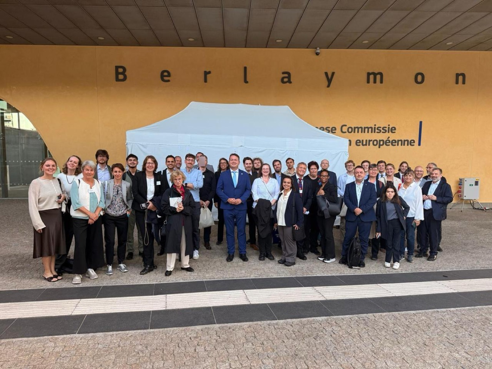
  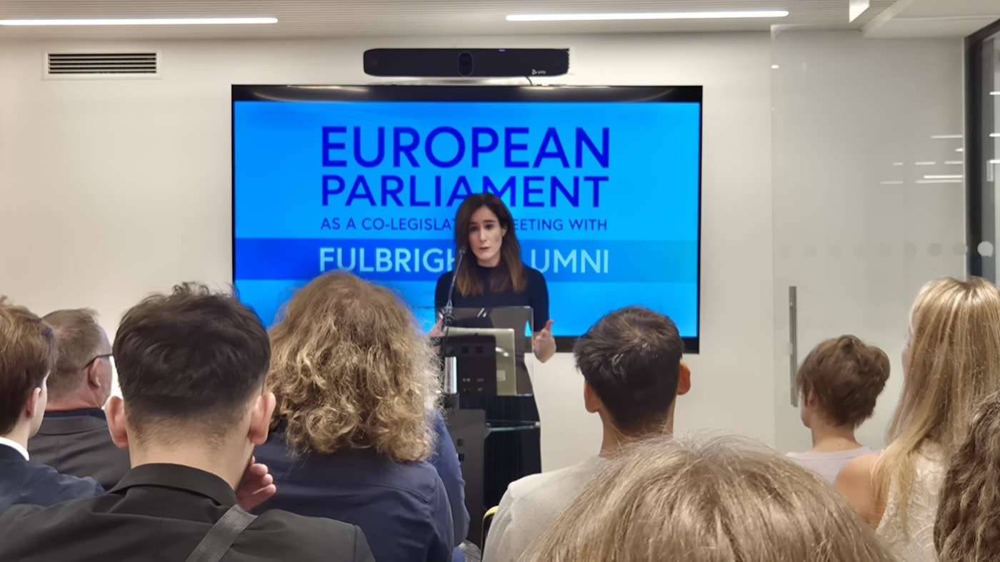<br>
  <em>Left: the delegation in front of the Berlaymont building of the European Commission. Right:
  <a href="https://www.linkedin.com/in/doradavid/">Dóra Dávid</a>, Member of the European Parliament,
  briefs the Fulbright alumni on the Parliament's role as co-legislator.</em>
</p>

In an era defined by rapid geopolitical shifts, fostering a robust transatlantic dialogue is more critical than
ever. Driven by this mission, the **German Fulbright Alumni Association (Fulbright Alumni e.V.)**, in close
cooperation with the **Hungarian Fulbright Association** and the **European Network of American Alumni
Associations (ENAM)**, organizes the European Fulbright Study Tours to the heart of European governance.

Upcoming delegations bring approximately **50 international Fulbright scholars** — currently completing their
exchange studies across Europe — and alumni to **Brussels** for an immersive, firsthand look at international
policymaking.

### A tradition of high-level dialogue

Past delegations have had the privilege of meeting, among others:

- **Former Grand Duke Henri of Luxembourg**
- **[Radmila Šekerinska](https://www.linkedin.com/in/radmila-sekerinska-474283a/)**, Deputy Secretary General of NATO, former Deputy Prime Minister and Minister of Defence of North Macedonia
- **Dr. Heike Peitsch**, German Ambassador to Luxembourg
- **Tamas Ivan Kovacs**, Ambassador of Hungary to Belgium and Luxembourg
- Senior representatives of the **European Parliament**, the **European Commission**, the **European Court of Justice**
  and the **European Public Prosecutor's Office**

<p align="center">
  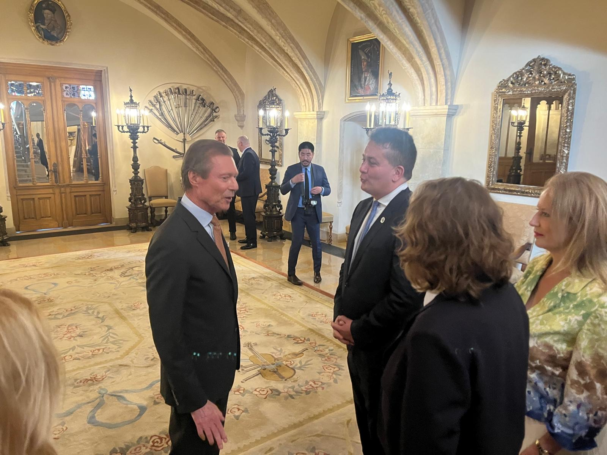<br>
  <em><a href="https://www.linkedin.com/in/gyorgykovacs/">Dr. György Kovács</a> in conversation with former Grand Duke Henri of Luxembourg</em>
</p>

<p align="center">
  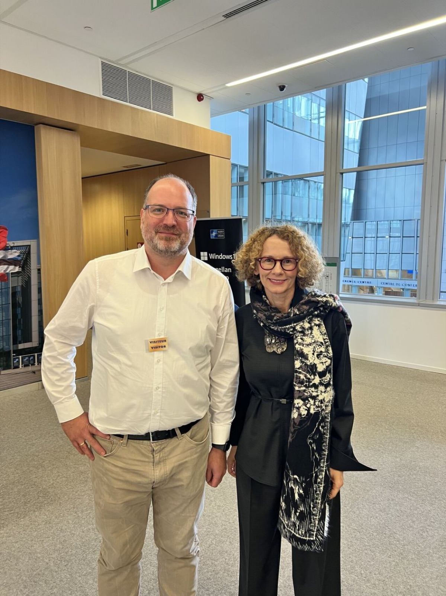<br>
  <em><a href="https://www.linkedin.com/in/radmila-sekerinska-474283a/">Radmila Šekerinska</a>, Deputy Secretary General of NATO, with organizer <a href="https://www.linkedin.com/in/olschimke/">Michael Olschimke</a> at NATO Headquarters in Brussels</em>
</p>

<p align="center">
  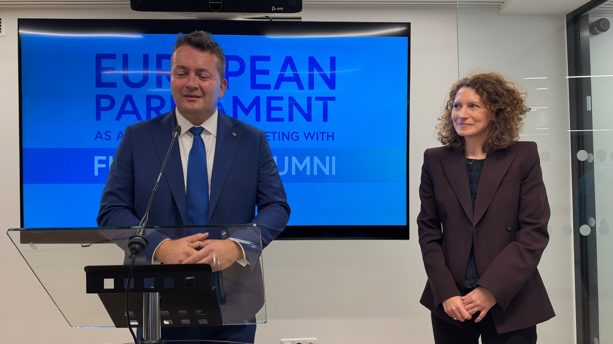<br>
  <em><a href="https://www.linkedin.com/in/gyorgykovacs/">Dr. György Kovács</a> introduces
  <a href="https://www.linkedin.com/in/eszter-lakos-6a454910/">Eszter Lakos</a>, Member of the European Parliament,
  to the group at the European Parliament</em>
</p>

By sharing these firsthand experiences on social media, the impact of each tour reaches far beyond the delegation
itself and sparks broader public engagement on transatlantic relations. The alumni magazine *FRANKLY* covered one of
the study trips ([PDF](https://fulbright.de/backend/fileadmin/user_upload/3_Alumniae_und_Partner/001_Alumniae/Frankly_2025_WEB_NEU-2.pdf), pages 22–23).

<p align="center">
  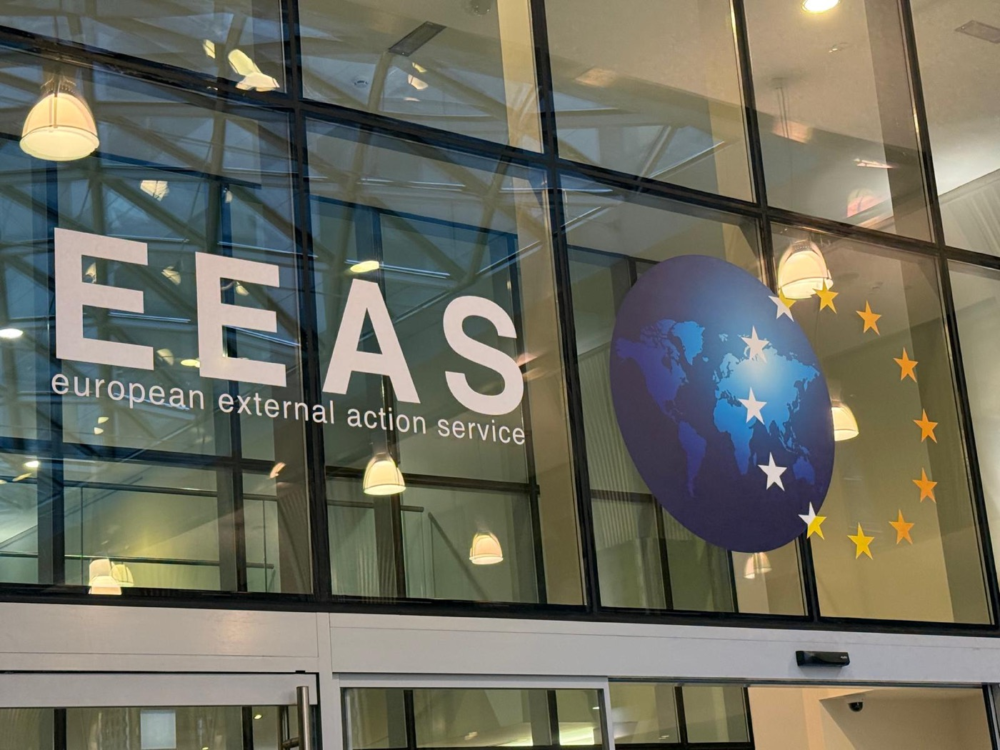
  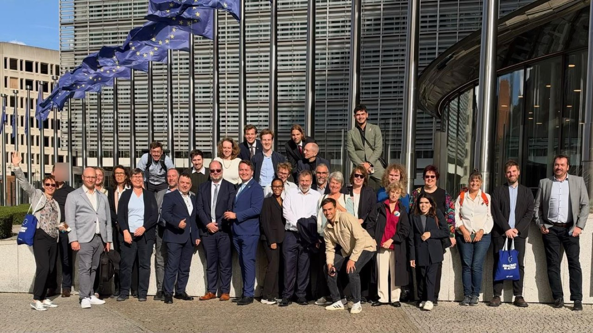
</p>

### Beyond borders: a lifelong network

> "I founded these study tours more than ten years ago, at a time when none of us could have anticipated how
> successful and truly international they would become. Yet when an initiative begins to bring people, institutions
> and ideas together in a meaningful way, you can sense that it is growing into something exceptional — even if you
> cannot yet foresee where the journey will lead."
>
> — **[Dr. György Kovács](https://www.linkedin.com/in/gyorgykovacs/)**, Founder of the Study Tour Initiative and
> Co-organizer on behalf of the Hungarian Fulbright Association

> "Throughout my career, I have been given many opportunities, often by mentors who never expected anything in
> return. You cannot pay that kind of generosity back. You can only pass it forward, and organizing these study
> tours is my way of doing that for the next generation of students.
>
> What makes the tours special is not only the people we meet in Brussels, but the delegation itself: current
> Fulbright students and alumni from every generation, outstanding people who learn as much from each other as from
> our hosts."
>
> — **[Michael Olschimke](https://www.linkedin.com/in/olschimke/)**, co-organizer, German Fulbright Alumni Association

The European Fulbright Study Tours are **entirely volunteer-driven**, carried by alumni who are passionate about keeping
the transatlantic friendship alive. With up to **70 applicants per trip**, the tours unite participants from many
countries well beyond Europe and the United States. By unpacking shared challenges and exploring how European
institutions work, the tours do more than educate — they build a lasting network of global changemakers.

### Hosting a delegation

If your institution would like to welcome a Fulbright delegation, the organizers take care of everything on the
visitor side: one point of contact, a confirmed list of attendees **in your own registration form** and by your
deadline, and the deletion of the attendees' identity data after the tour.

**Organizers:** [Dr. György Kovács](https://www.linkedin.com/in/gyorgykovacs/) (Hungarian Fulbright Association; Board Member, European Network of American
Alumni Associations) and [Michael Olschimke](https://www.linkedin.com/in/olschimke/) (German Fulbright Alumni Association),
with [Genevieve Brechelt](https://www.linkedin.com/in/genevievebrechel/) and [Vincent Sipeer](https://www.linkedin.com/in/vincent-sipeer/).

**Contact:** [michael.olschimke@fulbrightmail.org](mailto:michael.olschimke@fulbrightmail.org)

<p align="center">
  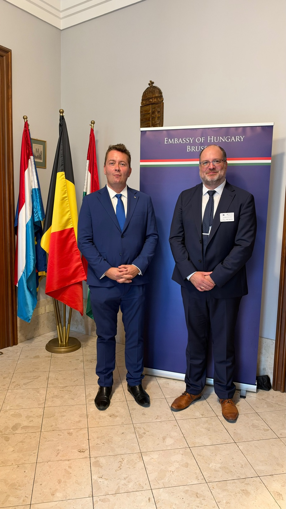<br>
  <em>The organizers <a href="https://www.linkedin.com/in/gyorgykovacs/">Dr. György Kovács</a> (left) and <a href="https://www.linkedin.com/in/olschimke/">Michael Olschimke</a> at the Embassy of Hungary in Brussels</em>
</p>

---

## Partners

<p align="center">
  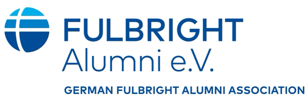
  &nbsp;&nbsp;&nbsp;
  
  &nbsp;&nbsp;&nbsp;
  
  &nbsp;&nbsp;&nbsp;
  <a href="https://www.scalefree.com"><picture>
    <source media="(prefers-color-scheme: dark)" srcset="docs/images/scalefree-logo-white.png">
    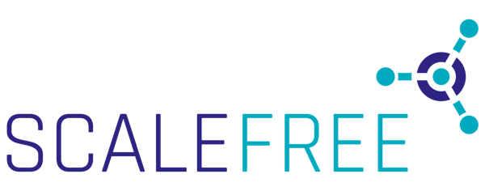
  </picture></a>
</p>

## Built and maintained by Scalefree

<p align="center">
  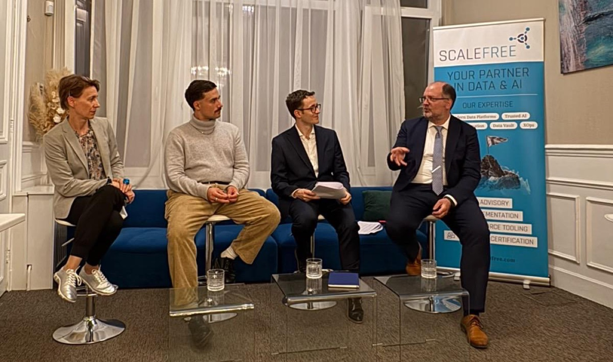<br>
  <em>Panel discussion with <a href="https://www.linkedin.com/in/katalin-feher-phd-12627613/">Dr. Katalin Feher</a>,
  <a href="https://www.linkedin.com/in/lukas-sieper-8582a2255/">Lukas Sieper</a>, Member of the European Parliament,
  <a href="https://www.linkedin.com/in/vincent-sipeer/">Vincent Sipeer</a> and
  <a href="https://www.linkedin.com/in/olschimke/">Michael Olschimke</a>, founder and CEO of Scalefree</em>
</p>

The European Fulbright Study Tours app — the macOS app **and** its Salesforce backend (data model, metadata package,
field mapping and integrations with Gmail, Google Drive, Docs, Slides, Calendar and Gemini) — is designed, built and
maintained by **[Scalefree](https://www.scalefree.com)** and contributed to the Fulbright alumni community as open
source.

Questions, bug reports and ideas are welcome as GitHub issues. For organizations that want to run the app with their
own Salesforce org, the [configuration](#1-organization-configuration-not-part-of-this-repository) and
[field mapping](#2-salesforce-fields--mapping-for-differently-configured-orgs) sections are the starting point.

---

## About this app

### Why the organizing team needs it

A study tour looks simple from the outside: a few days in Brussels, a handful of visits. Behind it, a small team of
volunteers — each with a day job — coordinates **several host institutions, around 50 participants from many
countries and dozens of deadlines** over roughly four months. Before this app, that work was spread across a process
spreadsheet, personal mailboxes, chat messages and Salesforce, and it ran into the same problems on every tour:

- **Every host has its own registration form.** Parliaments, ministries and embassies send their own Excel
  templates — different columns, date formats, country codes (full names here, ISO3 codes there) and dropdowns —
  each with its own deadline. Copying 50 participants into each form by hand is slow and error-prone, and a single
  wrong passport number can mean a participant is turned away at the security check.
- **Participant data arrives messy.** Names in capitals, phone numbers in every format, nationalities written in
  several languages, duplicate registrations, passports that expire before (or shortly after) the tour.
- **Passport data is sensitive.** It must be collected, passed on only to the hosts that need it, and deleted after
  the tour — with a record that this happened.
- **The mailboxes fill up.** Most attendee questions are the same (meeting point, dress code, documents, costs);
  emails from officials and their offices must never get lost among them.
- **The team changes.** Volunteers come and go between tours, so knowledge must not live in individual heads or
  mailboxes but in a shared, auditable system.

The app turns this into a guided routine: one place that shows what is due, what is missing and what needs
attention — and that does the repetitive work (cleaning data, filling host forms, drafting replies, logging emails,
deleting data) while the team keeps the decisions.

<p align="center">
  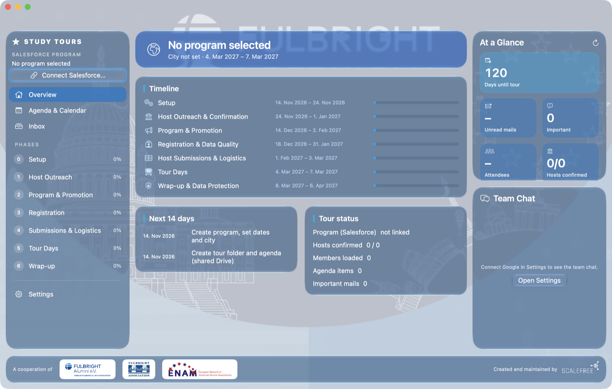
</p>

### How it works

The app guides the team through seven phases. Everything the team shares is stored in **Salesforce**; email,
documents and calendar live in **Google Workspace**; **Google Gemini** helps with emails and host forms. Every team
member signs in with their **own** Google account and their **own** Salesforce user; what the team shares (tour
folders, knowledge base, chat space) is shared with each person in Google — see [Team members](#team-members).

| # | Phase | What the app does |
|---|---|---|
| 0 | Setup | Creates the program (Campaign) in Salesforce, the tour folder in the shared Google Drive and a copy of the agenda template; creates the checklist as Salesforce Tasks |
| 1 | Host outreach | Shows the host visits (Opportunities on the program) with their stage, visit time, meeting address (Visit Location or the organization's address), speakers (VIP contacts linked as contact roles) and attached documents such as the host's own agenda; confirmed visits are put on the agenda with time, address and speakers |
| 2 | Program & promotion | Links to the agenda and the shared knowledge base used by the email assistant |
| 3 | Registration & data quality | Loads the attending members, cleans names, emails, dates and countries, converts phone numbers to international format (ITU-T E.164), checks ID documents (all details present, valid until one week after the last day of the program), finds duplicates — corrections are written back after review. Members with incomplete or invalid ID details can be asked by email to update them via a form; all attendees can be reminded to bring the document on record. These emails contain no document data and are logged on the member |
| 4 | Host submissions & logistics | Fills each host's **own Excel registration form** (attached to the Opportunity) with the attending members, respecting the form's dropdowns, country codes and date formats; review, then send via Gmail to the host's contact |
| 5 | Tour days | Attendance list, today's plan posted to the team chat |
| 6 | Wrap-up & data protection | Thank-you emails to hosts; deletion of passport and emergency-contact data in Salesforce with an audit record on every member |

<p align="center">
  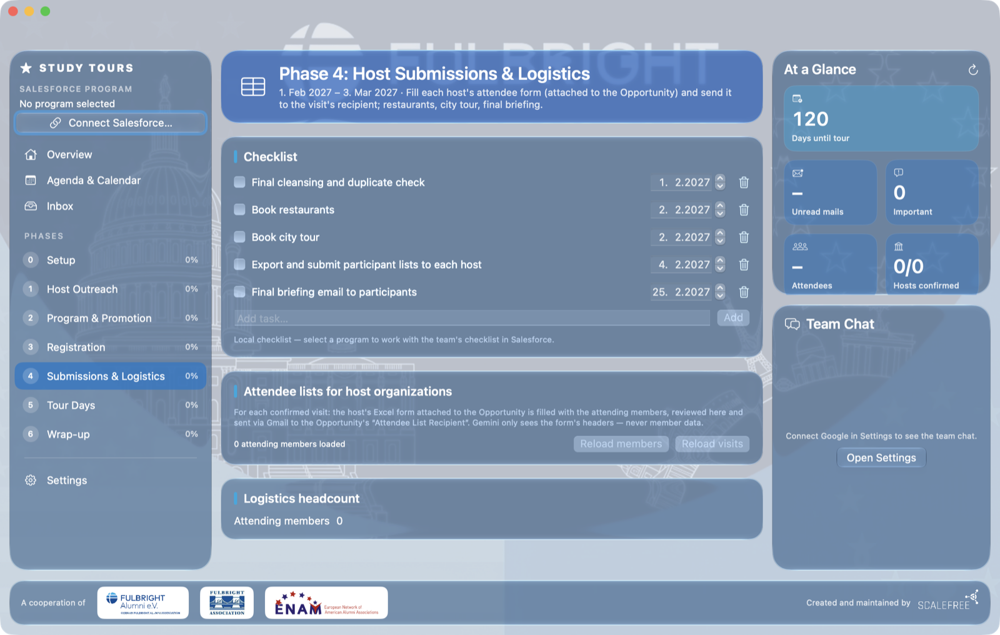
</p>

**Email assistant.** The app scans your own Gmail inbox, recognizes who wrote (members, officials and their offices,
the team), and drafts a reply for every email that needs one from the email and the knowledge base (a Google Doc) —
formal for officials and starting with the greeting stored on the contact. Replies keep everyone who was in the
original mail in CC, and you can add team members from the Salesforce user list. Drafts are signed with your name (first name for
members, full name for officials unless you are already on first-name terms), followed by your own Gmail
signature. **Nothing is ever sent automatically:** you review and edit each draft and click Send; the
reply goes out via Gmail in the original thread, the email is archived, and incoming and outgoing emails are
recorded as activities on the member or contact in Salesforce. New general facts from approved answers are added to
the knowledge base. Emails from officials are also highlighted under *At a Glance*, VIPs first.

**Salesforce stays up to date.** The app maintains the team's Salesforce records as part of the daily work instead
of as a separate chore. When an email arrives from someone who is not in Salesforce yet, the app proposes a new record
from the email: a **member** (Lead), added to the tour's program, for a prospective participant, or a **contact** with
their **organization** (Account) for an official or their office. You confirm the proposal; right before writing, the
app checks again that no record with that email address exists, so no duplicates are created. For any other sender
who is not in Salesforce, **Add sender to Salesforce** opens the same review on request. For new contacts the assistant
also suggests the **greeting** and whether the person is a **VIP** (holds the official role or is the person the group
visits, not an assistant); VIPs are marked with a crown wherever their mail appears. Every email exchanged
with a member or contact is logged as an activity on their record, and corrections from the data-quality check
(names, phone numbers, dates, countries) are written back after review.

**Agenda presentation.** *Create agenda* on the Agenda screen fills a fresh copy of the Google Slides template with
the public agenda entries — for attendees and for promotion. Confirmed host visits come onto the agenda with their
time, address and speakers (*Host Outreach → Add confirmed visits to agenda*). The previous agenda stays in the tour
folder as "previous version", and the program links to the new one. Edit the design in the template, not in the
generated copy. Placeholders in the template:

| Placeholder | Where | Replaced with |
|---|---|---|
| `{{tour}}`, `{{city}}`, `{{dates}}`, `{{year}}` | any slide | Program name, city, "28 September – 2 October 2026", year |
| `{{title}}` | the **entry slide** | Marks the slide that is repeated once per agenda entry, in date order; replaced with the host organization or event |
| `{{date}}`, `{{time}}` | entry slide | "Tuesday, 29 September 2026", "10:00 – 11:30" |
| `{{address}}` | entry slide | Visit Location, otherwise the host organization's address |
| `{{speakers}}` | entry slide | VIP contacts linked to the visit, one per line ("Name, Title") |
| `{{details}}` | entry slide | Other notes of the agenda entry |

**Team chat.** Below *At a Glance*, the app shows the organizing team's **Google Chat** space: read the latest
messages and write to the team without leaving the app. Status digests (overdue and upcoming tasks), the agenda and
today's plan can be inserted into the message box with one click — you review the text before it is sent. Messages
are sent as your own Google account; there is no bot. Each team member must be a member of the space.

**Privacy by design.** Member data (incl. ID data) is loaded from Salesforce into memory only and never stored on
the Mac. Gemini never sees member data when it reads a host form — only the form's headers; email text sent to
Gemini has ID-, passport- and phone-like numbers masked. Local copies of filled host forms are removed after sending.

---

## Using the app in your organization

### Requirements

- macOS 14 or later (the Liquid Glass design needs macOS 26; older versions fall back to a material design)
- Xcode 16 or later to build
- A Salesforce org (Sales Cloud with Campaigns, Leads, Contacts, Accounts, Opportunities, Tasks)
- Google Workspace / Google accounts for Gmail, Drive, Docs, Slides and Calendar, and a Google Cloud project for the OAuth client
- A Google Gemini API key ([Google AI Studio](https://aistudio.google.com))

### Build

```bash
./scripts/build-app.sh            # → dist/Fulbright Study Tours.app
swift test                        # unit tests
```

### 1. Organization configuration (not part of this repository)

Copy the example and fill in your values:

```bash
cp config/studytours.config.example.json config/studytours.config.json
```

| Key | Meaning |
|---|---|
| `salesforceURL` | Your Salesforce My Domain URL |
| `salesforceConsumerKey` | Consumer Key of your Salesforce External Client App |
| `googleClientId` | Google OAuth client ID (Desktop app) |
| `driveParentFolderId` | Shared Google Drive folder that contains one folder per study tour |
| `agendaTemplateId` | Google Slides template copied into each tour folder |
| `knowledgeBaseURL` | Default knowledge base (Google Doc) for the email assistant |
| `googleChatSpace` | Optional: link to the team's Google Chat space (can also be picked in the app's Settings) |
| `geminiSponsorKeySuffix` | Optional: last characters of a sponsored Gemini API key. With that key the footer says "… AI tokens sponsored by" the maintainer; any other key shows "Custom Gemini AI key applied · … tokens used". The token count is the lifetime total on that Mac |

`config/studytours.config.json` is git-ignored. The build script bundles it into the app.

### 2. Salesforce fields — mapping for differently configured orgs

All objects, fields and picklist values the app uses are listed in
[`config/salesforce-mapping.default.json`](config/salesforce-mapping.default.json): standard fields
(`Lead.FirstName`, `Opportunity.StageName` values …) as well as custom fields (`Birth_Date__c`, `Visit_Start__c` …).
If your org uses different names or values, copy it to `config/salesforce-mapping.json` and change **only the
entries that differ** — everything else falls back to the defaults. Examples: a different birth-date field, another
picklist value for "attending", other Opportunity stage names, other phase labels.

| Group | Salesforce object | Used for |
|---|---|---|
| `member` | Lead | Participants and their (ID) data |
| `programMember` | CampaignMember | Attendance status ("attending" value) |
| `program` | Campaign | The study tour: type, city, Drive folder, agenda, knowledge base |
| `task` | Task | Checklist (phase picklist and its values) |
| `hostVisit` | Opportunity | Host visits: visit time, list deadline, list recipient, stage values |
| `contact` | Contact | Officials (greeting) |

### 3. Salesforce metadata package

[`salesforce/`](salesforce/) contains the custom fields the app needs and a permission set — additive only, see
[`salesforce/METADATA-REVIEW.md`](salesforce/METADATA-REVIEW.md). The deploy script fills in values from your config:

```bash
salesforce/deploy.sh validate <org-alias>   # check-only, changes nothing
salesforce/deploy.sh deploy <org-alias>
sf org assign permset --name Fulbright_Study_Tours --target-org <org-alias>
```

**Everything the app needs in Salesforce** — every object, standard field, custom field and picklist value — is listed
in [`salesforce/SCHEMA.md`](salesforce/SCHEMA.md). Fields that already existed in the Fulbright org (member ID data,
attendance status, greeting) are not in the main package; deploy them with the **prerequisites package** or map your
own fields in the mapping file:

```bash
salesforce/deploy.sh validate <org-alias> prerequisites
salesforce/deploy.sh deploy <org-alias> prerequisites
```

**External Client App:** callback `http://localhost:8765/callback`, scopes `api` and `refresh_token`, PKCE enabled,
no client secret required. Put its Consumer Key into the config file.

### 4. Google

Create an OAuth client of type *Desktop app* in a Google Cloud project, enable the Gmail, Drive, Docs, Slides,
Calendar, Google Chat and People APIs and put the client ID into the config file; the client secret is entered once
in the app's Settings and kept in the macOS Keychain. Requested scopes: `gmail.modify`, `drive`, `documents`,
`calendar.events`, `chat.messages`, `chat.spaces.readonly`, `directory.readonly` (sender names in the chat).

**Team chat:** the Google Chat API is only available for Google Workspace accounts, and Google requires the Chat API
to be configured in the Cloud project (*Google Chat API → Configuration*: app name, avatar, description) even though
the app only acts on behalf of the signed-in user.
With a Google Workspace you can register the app as *internal*; otherwise Google's rules for external apps in
testing mode apply.

### Team members

Every team member uses the app with their **own** Google account (Gmail, Drive, Calendar, Chat) and their **own**
Salesforce user — nothing is shared through a common login. An administrator gives each new team member access to
what the team shares:

| What | Who sets it up | Access each team member needs |
|---|---|---|
| **Salesforce** | Salesforce admin | An active user and the permission set **Fulbright Study Tours** |
| **Tour folder in Google Drive** (`driveParentFolderId`) | Owner of the folder | One shared folder for all tours, shared with every team member as **Editor** — the app creates one subfolder per tour in it and copies the agenda into it. Use a Google Group to share it once for the whole team |
| **Agenda template** (`agendaTemplateId`) | Owner of the template | At least **Viewer**, so the app can copy it into a new tour folder |
| **Knowledge base** (`knowledgeBaseURL`) | Owner of the document | **Editor** — the assistant reads it for replies and adds new facts from approved answers |
| **Google Chat space** for the team | Chat space manager (admin) | **Member of the space**; then each person picks the space once in *Settings → Connections → Team chat* (or it is preset with `googleChatSpace`) |

Without the Drive sharing the app cannot create or open the tour folders and the assistant answers without the
knowledge base; without the Chat membership the team chat panel stays empty for that person.

### 5. Logos and artwork

Logos and the background artwork are trademarks of their owners and are not included — see
[`Resources/Logos/README.md`](Resources/Logos/README.md). Without them, the app shows the partners' names as text.

---

## Data protection

- **Attendees** are the program's members with the attendance status *Attending* (configurable). This one definition
  is used for the attendee count, the member list, the data checks, the "passport incomplete" count and the host lists.
- After the tour, the app clears a fixed set of fields — date of birth, ID type, passport/ID number, expiry date,
  issuing country, emergency contact and emergency phone — on **all** members of the program, whatever their
  attendance status (including invited, applied and cancelled), and records a completed Task ("Data protection:
  passport data deleted") on every member. The fields cannot be deselected. Administrators (*Modify All Data*) can
  run the same deletion across the whole org.
- Every attendee list sent to a host leaves a "data shared with …" record on each member.
- Secrets (refresh tokens, API key, Google client secret) are stored in the macOS Keychain.

---

## License

Copyright 2026 Fulbright Alumni e.V. Licensed under the [Apache License, Version 2.0](LICENSE); see also [NOTICE](NOTICE).

The Fulbright name and logo, the logos of the partner organizations and the background artwork are not covered by
this license; their use is subject to the respective owners' terms (for the Fulbright marks: the Fulbright Visual
Identity Standards).
